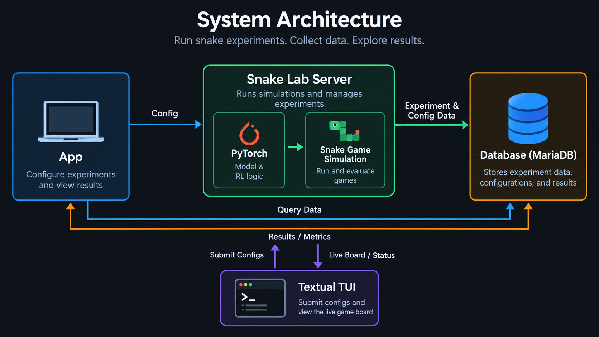

Snake Lab runs queued Snake experiments serially on CPU, stores results in
MariaDB, and streams progress to a Textual client or external subscribers.

## Components

- A systemd simulation server.
- ZeroMQ job control on TCP port 41970.
- ZeroMQ live telemetry on TCP port 41971, with per-move frames generated
  only while a viewer subscribes.
- ZeroMQ simulation-ended events on TCP port 41972.
- A Textual client for submitting configurations, watching the game, and
  controlling a run.
- MariaDB storage for resolved configurations, run state, and episode results.

## Application packages

All runtime code lives in `snakelab/`, with shared constants in `snakelab/constants/`.

| Folder | Main modules and responsibilities |
| --- | --- |
| `server/` | `SimulationServer` handles control requests and the FIFO run queue. `SimulationRun` holds progress; `SimulationControl` handles pause, cancellation, and delay. `Simulator` runs episodes and training. `Configuration` resolves and validates input through `JSONValidator`. |
| `game/` | `SnakeGame` owns an episode; `GameRules` applies moves to immutable `GameState`. `Position`, `Direction`, `RewardConfig`, and `StepResult` describe game values. `BoardSnapshot` converts boards for transport; `GameHelper` places food. |
| `nn/` | `SequenceModel` defines the shared RNN/Transformer interface. `ActionPolicy` combines model inference, `EpsilonAlgo`, and `EpsilonNiceAlgo`. `ReplayMemory` samples episode windows, and `Trainer` performs Double DQN updates. |
| `database/` | `SimulationStore` defines the server's storage contract. `SnakeDb` implements it through the generic MariaDB manager `DbMgr`; `DBHelper` maps and hashes configurations. `MemorySimulationStore` supports ephemeral runs. |
| `zmq/` | `Protocol` defines control messages; `ZMQHelper` defines completion events. `TelemetryPublisher`, `EventsPublisher`, and `TelemetrySubscriber` own transport. `TelemetryEnvelope` and `FrameTelemetry` represent live updates. |
| `client/` | `__init__.py` currently holds the Textual app and dialogs. `AsyncLabClient` sends control requests; `SnakeBoard`, `LivePlots`, and `client.tcss` provide presentation. `ConfigurationReader` reads run settings through `SnakeDb`. |
| `schemas/` | Simulation configuration v2 JSON Schema and database migrations v1–v6. The older configuration v1 schema remains in the repository. |
| `utils/` | `MyLog` provides shared logging. |

## Execution flow

1. A control request reaches `SimulationServer` on port **41970**. The server
   resolves the configuration, stores a new run, and queues it.
2. One worker passes the resolved configuration to `Simulator`, which combines
   game rules, policy inference, replay memory, and training on CPU.
3. Episode results go to the store and telemetry on port **41971**. Per-move
   frames are generated only while a matching viewer subscription exists.
4. The server stores the terminal result before publishing `simulation_ended`
   on port **41972**. Successful runs also save their high-score board.

`python -m snakelab.server` starts the server; `--ephemeral` uses memory
instead of MariaDB. `python -m snakelab.client` starts the TUI. The client
uses ZeroMQ for control and telemetry, and a separate read-only database
transaction for its configuration panel.

## Observations, models, and exploration

Both models consume the same 23-value feature vector adapted from Hydra's
older `UNUSED_get_state()` representation. There is no rotating board window.

| Indices (zero-based) | Features |
| --- | --- |
| 0–2 | Body danger: left, straight, right |
| 3–5 | Wall danger: left, straight, right |
| 6–9 | Heading: left, right, up, down |
| 10–13 | Food direction: left, right, up, down |
| 14–15 | Food shares the head's X coordinate, Y coordinate |
| 16–22 | Snake length, seven big-endian bits |

All values are floats containing zero or one. Danger checks share the actual
game collision rules, including legal moves into a vacating tail. Terminal
boards without food have six zero food features. Length saturates at 127;
longer snakes remain encoded as 127, rather than wrapping to zero.

`model.type` chooses `rnn` (the default) or `transformer`. The RNN and Transformer
share `hidden_size`, `layers`, and `dropout`. The Transformer also uses `heads`,
a feedforward width of four times `hidden_size`, fixed sinusoidal positional
encoding, and causal attention over the configured observation window. Its
position encodings and causal mask are cached buffers. `forward_sequence()`
returns `[batch, time, action]`; `forward()` returns `[batch, action]` for the
last frame. Replay and Double DQN training are independent of model choice.
Models trained with the former 51-value observation have incompatible inputs.

Ordinary epsilon chooses random actions during its decay schedule. Once it
falls below 0.0001, EpsilonNice can start occasional exploration detours. With
the defaults, each eligible non-detour move has a 0.005 chance of scheduling
20 detour moves, beginning on the following move. Each detour move chooses a
safe action different from the model's suggestion, including when that
suggestion is already safe. If no safe alternative exists, the original
suggestion is retained. Safety means avoiding an immediate body or wall
collision; it does not guarantee escape from a longer-term trap.

Detours reset at episode boundaries. `epsilon_nice.probability: 0` disables
them. Ordinary epsilon and EpsilonNice use separate seeds. Actual Nice
overrides are counted separately in episode results, run summaries, the
client, and persisted episode rows; cumulative algorithm statistics are
logged with the periodic run progress.

Database migration v6 adds the model/exploration configuration and Nice
override counts. Historical rows default to RNN and disabled EpsilonNice.
Run the usual upgrade or schema application script before starting the new
server against an existing database.

## Supporting folders

| Folder | Purpose |
| --- | --- |
| `snakelab/constants/` | Runtime defaults, ports, version, game values, and database configuration paths. |
| `client/` | Shell launchers for the installed and development clients. |
| `scripts/` | Installation, upgrades, schema application, environment setup, backups, cleanup, benchmarks, and isolated database tests. |
| `systemd/` | Service definition for the installed server. |
| `tests/` | Unit, boundary, and integration tests, including ZeroMQ and optional MariaDB tests. |
| `examples/` | Sample simulation configuration. |
| `pages/`, `notes/` | Website documentation, images, and release notes; `index.md` is the homepage. |
| `.github/` | Repository automation. |

See [Developer integration](/pages/developer.html) for wire protocols and
runtime details, and [Coding guidelines](/pages/coding-guidelines.html) for
design conventions.
